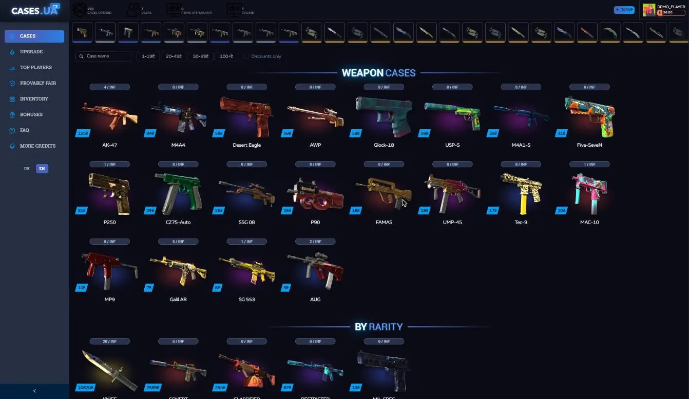
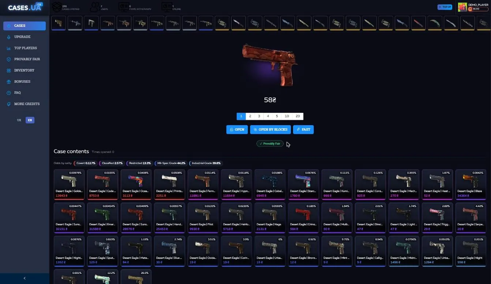
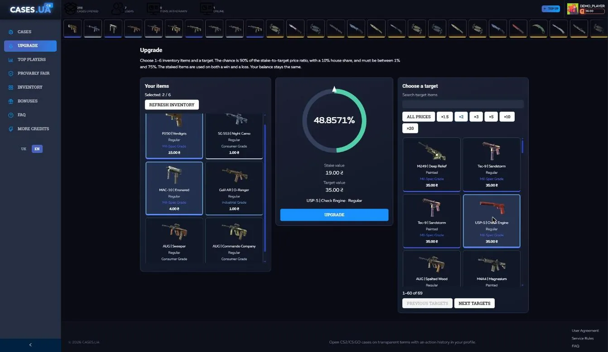

# CASES.UA

A CS2-style case-opening site: open cases, collect skins, sell them or try to upgrade them into
something better. Every draw can be checked by the player afterwards.

It is a demo that runs on virtual credits. There are no real-money payments: deposits and withdrawals
are simulations, and nothing on the site can be cashed out. The interface is in Ukrainian and English
and works on phones.



## What's inside

- **74 cases in five sections.** Weapon cases (every skin of one weapon), cases by rarity, knife-chance
  cases, knife cases and CS2 collections. Every item in a case shows its exact chance.
- **Provably fair draws.** Each result comes from a server seed whose hash the player sees in advance,
  the player's own client seed and a counter. After rotating the seed, anyone can recompute a case open or
  an upgrade on the Provably Fair page.
- **Upgrade.** Stake up to six skins for a chance at a more expensive one; the chance is 90% of the price
  ratio, between 1% and 75%.
- **Inventory.** Sell skins for credits or request a (simulated) withdrawal.
- **Around the game:** daily and one-time bonuses, promo codes, a live feed of drops, chat, player
  profiles and a top list.
- **Admin panel:** statistics, cases and prices, players (balance corrections, chat mutes), articles, promo
  codes, an action log and settings.





## Tech stack

- **Frontend:** React 17, Redux, Ant Design, SCSS, i18next, Socket.IO client.
- **Backend:** Node.js, Express, Sequelize on MySQL 8, Redis, Socket.IO, JWT auth.
- **Infrastructure:** Docker Compose, nginx locally and Caddy with automatic HTTPS in production,
  scheduled MySQL backups, GitHub Actions running the backend and frontend test suites.

## Run it locally

You need Docker. In the repository root:

```sh
cp .env.example .env
```

Set `JWT_SECRET` in `.env` to a long random value, for example the output of
`node -e "console.log(require('crypto').randomBytes(48).toString('hex'))"`. Then start the stack and fill
the empty database once:

```sh
docker compose up -d --build
docker exec fullstack_case_backend sh -c "npm run seed && node scripts/buildPriceMap.js && node scripts/seedCases.js"
docker compose restart backend
```

Open http://localhost:3009 and register. Email is off until you add Resend settings to `.env`, so
registration signs you in straight away.

### Without Docker

You need Node.js, MySQL 8 and Redis. Create an empty `case` database and a `backend/.env` with at least
`DB_HOST`, `DB_PORT`, `DB_NAME`, `DB_USER`, `DB_PASS` and `JWT_SECRET`, then:

```sh
cd backend
npm install
npm run migrate
npm run seed && node scripts/buildPriceMap.js && node scripts/seedCases.js
npm start
```

and in another terminal:

```sh
cd frontend
npm ci --legacy-peer-deps
npm start
```

The site opens on http://localhost:3000 and talks to the API on port 3003.

## Running a server

Deploying to a VPS with HTTPS, updates, backups and restores are covered in the
[operator's guide](ops/README.md).

---

CS2 item names and images belong to Valve Corporation. This project is not affiliated with Valve.
